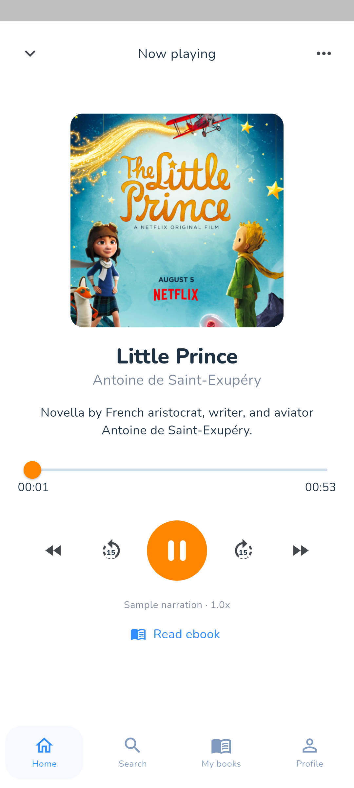
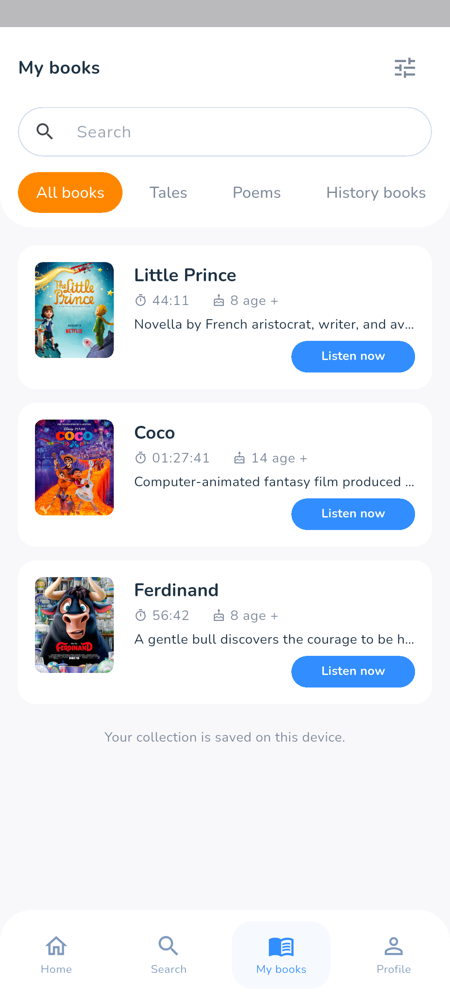
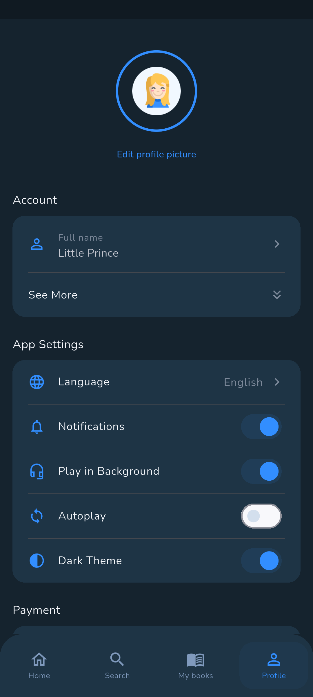
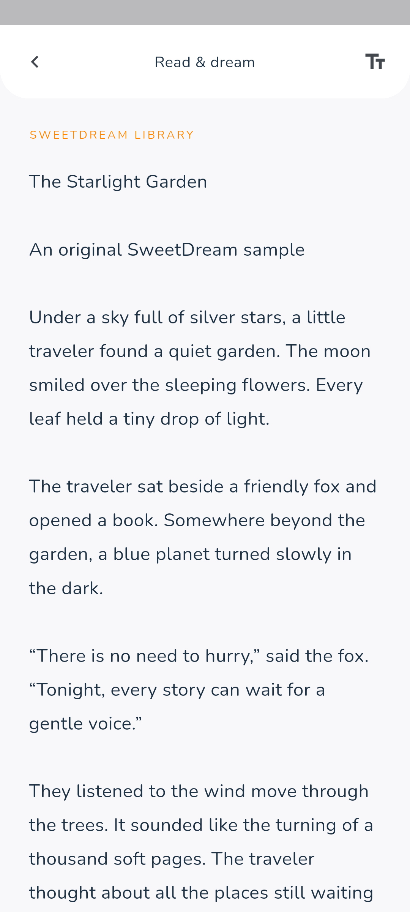

# SweetDream · Flutter 有声书与电子书

基于 Pixso 文件 **Sweet dream** 开发，已通过 MCP 读取主界面、Cover 和 Symbols 三个分类。42 个手机画板合并为可交互的页面与状态，支持浅色/深色主题。

## 界面预览

| 首页 | 搜索 | 播放 |
| --- | --- | --- |
|  |  |  |

| 书架 | 个人资料（深色） | 电子书 |
| --- | --- | --- |
|  |  |  |

## 交付内容

- Flutter Android / iOS 工程，12 个 Dart 实现文件。
- 首页、搜索与组合筛选、书架、资料设置、播放器、结账介绍、注册登录及密码重置流程。
- 离线原创语音试听、进度控制、倍速、睡眠定时、迷你播放器与原创电子书阅读。
- 主题、姓名、邮箱、性别、生日、设置和书架的本地保存。
- [项目结构和架构说明](docs/ARCHITECTURE.md)。
- [设备验证记录](docs/TESTING.md)，[浅色总览](docs/overview-light.jpg)，[深色总览](docs/overview-dark.jpg)。
- [42 个设计画板的页面映射及截图索引](docs/UI-MAPPING.md)。
- [Pixso 节点清单](docs/design-inventory.json)，[原始设计](docs/reference/)，[应用截图](docs/screenshots/)。

## 启动

已经生成 [Android 安装包](dist/README.md)：ARM64 手机约 19.9 MB，x64 模拟器约 21.3 MB。

```powershell
flutter pub get
flutter run -d emulator-5554
```

本机已有运行中的 Android 11 模拟器，直接复用。无需创建新模拟器。

```powershell
flutter analyze
flutter test
powershell -ExecutionPolicy Bypass -File scripts/verify-android.ps1
```

最后一条命令运行实际 Android 交互测试并重新生成截图，测试脚本会恢复模拟器原来的显示配置。

交付前已清理约 1.9 GiB 构建中间文件，源码、文档、截图和安装包共约 77.6 MiB。再次运行前执行 `flutter pub get` 即可恢复必要的本地生成文件。

## 目录概要

```text
lib/
  main.dart                 启动入口
  app.dart                  导航壳、主题、欢迎页、迷你播放器
  core/                     应用状态、音频、本地偏好、设计主题
  data/                     书籍与筛选模型、原创示例内容
  screens/                  各业务页面
  widgets/                  可复用视觉组件
assets/                     Pixso 素材、Nunito 字体、离线语音
android/ · ios/             平台工程
integration_test/           设备交互及截图验证
test/ · test_driver/         单元测试与截图保存驱动
docs/                       架构、画板映射、截图与设计来源
```

## 实现范围

这是可运行的本地 UI 原型。注册、登录、重置密码和付款为演示流程，未连接后台、社交登录、邮件或真实支付；密码和银行卡信息不保存、不发送。图书封面与插画来自用户提供的 Pixso 设计，仅用于设计还原；未附带相关作品的全文或授权录音。所有书籍的试听与阅读共用原创短篇 **The Starlight Garden**，界面已标记示例内容。

iOS 工程保留，但当前 Windows 环境不能运行 Xcode，因此 iOS 构建与设备验证尚未执行。
