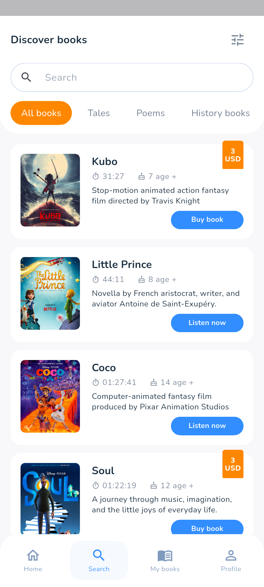
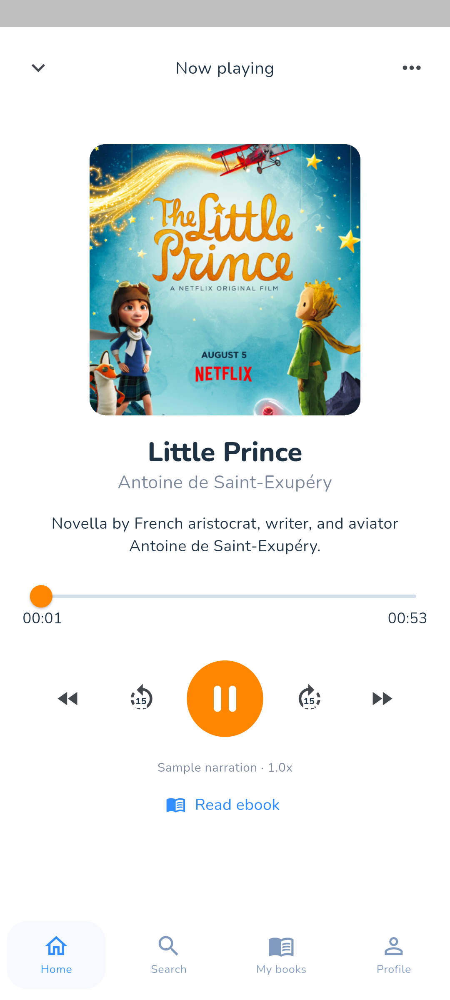
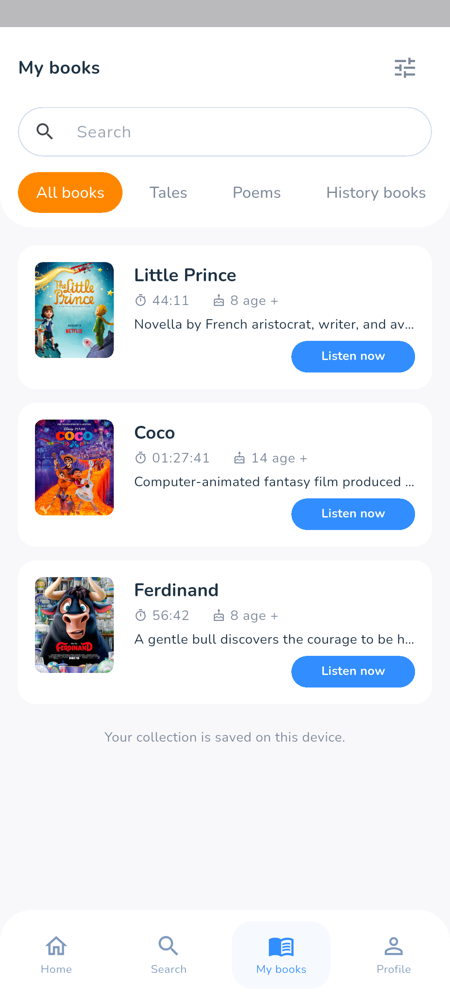
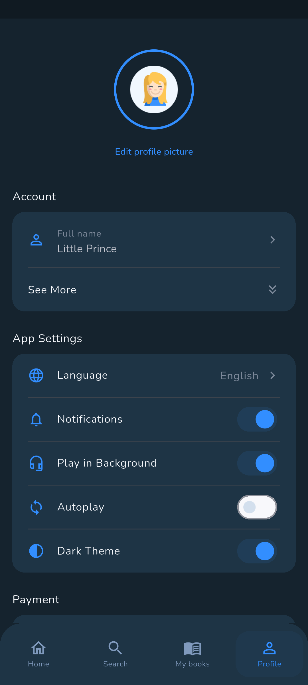
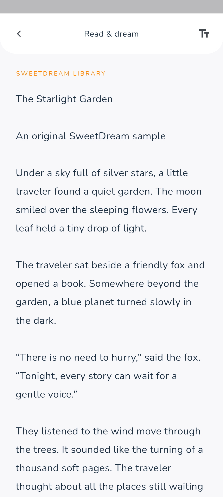
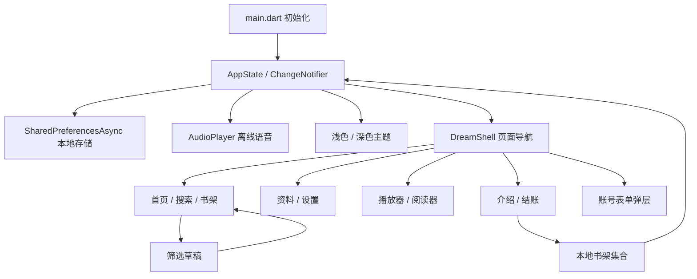

# SweetDream 项目结构与架构

## 项目定位

根据 Pixso 当前文件 `Sweet dream` 实现的 Flutter 有声书与电子书应用原型。所有产品页面采用 Flutter 原生组件绘制，文字、列表、表单、主题和播放控件可交互；设计图没有作为整张背景覆盖页面。

读取日期：2026-11-13（Asia/Tokyo）。MCP 读取文件中的全部分类：

| Pixso 分类 | 内容 | 开发处理 |
| --- | --- | --- |
| 🍭 Sweet dream | 42 个手机画板，375×812 | 转化为共享页面和浅色/深色、播放、展开、滚动、输入等状态 |
| 🔖 Cover | 3 个宣传展示画板 | 导出为参考，未当作额外应用页面 |
| 🚀 Symbols | 28 个顶层组件或组件集合 | 提取书籍封面、头像和插画，复用导航、卡片、输入框等设计规范 |

## 主要界面

以下是运行于 Android 模拟器的应用截图。完整状态截图及原始设计对照见 [页面映射表](UI-MAPPING.md)。

| 首页 | 搜索 | 播放器 |
| --- | --- | --- |
|  |  |  |

| 书架 | 深色资料页 | 电子书 |
| --- | --- | --- |
|  |  |  |

## 目录结构

```text
SweetDreamAudioBookEbook/
├── lib/
│   ├── main.dart               # 初始化持久化状态，启动应用
│   ├── app.dart                # 主题、导航壳、底部导航、欢迎页、迷你播放器
│   ├── core/
│   │   ├── app_state.dart      # ChangeNotifier、音频、设置、书架、本地保存
│   │   └── theme.dart          # Nunito、颜色、输入框、滑块、开关主题
│   ├── data/
│   │   └── books.dart          # 书籍模型、5 本示例、筛选模型、原创阅读示例
│   ├── screens/
│   │   ├── catalog.dart        # 首页、搜索、书架共享列表
│   │   ├── filter.dart         # 筛选草稿与提交
│   │   ├── profile.dart        # 资料、设置、付款入口、支持信息
│   │   ├── player.dart         # 全屏播放、倍速、定时、电子书阅读
│   │   ├── checkout.dart       # 书籍介绍、付款演示、入架
│   │   └── auth.dart           # 注册、登录、重置密码共享弹层
│   └── widgets/
│       └── common.dart        # 按钮、页头、封面、书籍卡片、提示
├── assets/
│   ├── images/                # 经 Pixso MCP 导出的局部素材
│   ├── fonts/                 # Nunito 变量字体及 OFL 许可证
│   └── audio/starlight.mp3    # 本地生成的原创短篇试听语音
├── android/                   # Android 工程
├── ios/                       # iOS 工程，待 macOS/Xcode 构建验证
├── test/book_filter_test.dart       # 组合筛选的行为测试
├── integration_test/          # Android 真实插件与完整流程验证
├── test_driver/               # 保存设备截图的驱动
├── scripts/verify-android.ps1 # 复用模拟器并恢复测试前显示设置
└── docs/
    ├── ARCHITECTURE.md         # 本文档
    ├── UI-MAPPING.md           # 42 画板到实现与截图的映射
    ├── design-inventory.json   # MCP 节点编号、分类和截图信息
    ├── reference/             # Pixso 原始画板与封面展示图
    └── screenshots/           # 实际 Android 应用截图
```

## 架构与数据流



`AppState` 是应用级状态，负责音频生命周期、当前书籍、主题、个人资料、设置和已拥有书籍。页面通过 `ListenableBuilder` 观察状态，操作通过业务方法或 `update` 提交，持久化通过 `SharedPreferencesAsync` 完成。

搜索文本、分类选择、密码可见性、付款字段、账号表单和筛选草稿留在页面局部状态中。退出筛选而未提交不会更改生效条件。注册和登录共用表单，包含弹层与全屏标签两种布局，避免为参考中的空白/已填写状态复制页面代码。

只有音频和本地偏好使用外部运行时包，未引入路由、状态管理、数据库或网络图片框架。书籍和插画随应用打包，首屏不依赖网络。

## 交互与行为

| 功能 | 已实现行为 |
| --- | --- |
| 欢迎 | 点击或横向滑动进入；本地记住已进入 |
| 首页 | 促销入口、通知信息、书籍列表、底部导航 |
| 搜索 | 标题实时搜索、4 个分类、清空、无结果状态 |
| 筛选 | 年龄下限、时长范围、语言、免费/付费、付费价格范围、重置 |
| 书架 | 已拥有书籍；免费书可直接入架；模拟购买后入架并本地保存 |
| 播放 | 实际播放内置语音、暂停、进度拖动、前后 15 秒、切换书籍、迷你播放器 |
| 播放选项 | 0.75/1/1.25/1.5 倍速、5/15/30 分钟定时关闭、自动下一本 |
| 阅读 | 原创短篇电子书，滚动和字号调整 |
| 个人资料 | 展开、编辑姓名/邮箱/性别/生日并保存 |
| 设置 | 双主题、本地设置持久化；关闭后台播放时应用退后台即暂停 |
| 结账 | 卡号长度、有效期、CVV 校验；保存开关；确认弹窗；模拟购买 |
| 账号 | 注册/登录表单校验；密码显示隐藏；重置密码页面流转 |

## 设计实现

- 主色 `#328EFF`，强调色 `#FF8700`，浅色背景 `#F8F8FB`，正文 `#1E3243`。
- 深色背景 `#15232E`，表面 `#1E3445`。
- 采用 Pixso 中读取到的 Nunito 字体；卡片圆角 16，页头和弹层圆角 28，主按钮胶囊形。
- 书籍封面按约 3 倍尺寸导出，避免引入整个设计文件。播放器使用原始方形封面节点。
- 原稿个别深色卡片的标题和封面不一致，实现统一使用书籍自己的封面。
- 原稿的静态时间和章节文字与本地短篇音频不相同；播放器显示真实音频时长和位置，列表保留参考的书籍时长。

## 演示边界

该项目没有用户提供的后端、邮件服务、支付服务、完整电子书或授权有声书文件。账号、重置密码和购书均明确标记为本地演示，社交登录入口显示未连接服务说明。密码、银行卡号、有效期和 CVV 不保存、不发送；“保存卡片”开关仅演示视觉状态。

所有书籍试听共用原创短篇 `The Starlight Garden` 的离线合成语音。阅读器显示同一原创短篇，未将其标为原著全文。完整作品内容、线上下载、系统媒体通知、长期后台播放服务和生产支付需另行接入。

语言项保存用户偏好；示例目录仅含英文，俄语筛选显示无结果。通知开关保存偏好，未接入推送。头像按钮保留设计素材，未接入相册上传。退出入口打开演示登录页，没有真实服务器会话。

## 运行与验证

```powershell
flutter pub get
flutter run -d emulator-5554
flutter analyze
flutter test
powershell -ExecutionPolicy Bypass -File scripts/verify-android.ps1
```

验证脚本复用已运行的 `emulator-5554`，不创建或下载 AVD。为了统一手机截图，测试期间暂用 1080×2400 / 432 dpi，`finally` 恢复测试前显示配置。

Android 构建使用 Flutter 3.47.7、Dart 3.13.5、AGP 8.11.1、Gradle 8.14、Kotlin 2.2.20。此组合复用本机已有缓存。Flutter 会提示未来支持版本的升级建议；当前构建结果以实际验证记录为准。

依赖 API 和构建兼容说明：[audioplayers](https://pub.dev/packages/audioplayers)、[shared_preferences](https://pub.dev/packages/shared_preferences)、[Android Gradle Plugin 8.11](https://developer.android.com/build/releases/agp-8-11-0-release-notes)。

## 后续接入位置

将 `data/books.dart` 的样例列表替换为内容仓库，将 `app_state.dart` 中的入架与偏好操作接到仓库接口；生产鉴权与支付完成后，由 `auth.dart` 和 `checkout.dart` 调用对应服务。音频资源按书籍分配并接入媒体服务，阅读器换为真实章节数据。新增后端时应保持卡号和密码由专门服务处理。


